# Analyst Agent

A personal data platform: my expense tracker (Google Sheets) → Databricks (bronze / silver / gold) → dashboard → an LLM data-analyst agent that answers questions in plain English.

Status: **Phase 1 in progress**: `silver.transactions` is built and reconciles with the sheet's own totals. It now
also carries the flags from my old Power BI workbook (reimbursable rows, study year and semester), so the gold
tables and the agent can separate personal living spend from work money and one-off fees. Next: gold tables and the dashboard.

## The big picture

Four platforms, each with one job. GitHub is the hub that connects the other three.

```mermaid
flowchart LR
    subgraph Laptop["💻 Laptop (VS Code)"]
        code[Write code]
    end
    subgraph GitHub["🐙 GitHub"]
        repo[(Repo<br/>tthymept/Analyst-Agent)]
        deploy[deploy workflow<br/>on every push]
        ingest[ingest workflow<br/>daily 02:00 SGT]
        secrets[[GitHub Secrets]]
    end
    subgraph Google["📊 Google"]
        sheet[Expense sheet]
    end
    subgraph Databricks["🧱 Databricks"]
        volume[(Volume<br/>bronze.raw)]
        job[sheet_pipeline job]
        table[(bronze.sheet_rows)]
        silver[(silver.transactions)]
    end

    code -- git push --> repo
    repo --> deploy -- bundle deploy --> job
    repo --> ingest
    secrets -.-> deploy & ingest
    sheet -- read-only API --> ingest
    ingest -- upload JSON snapshot --> volume
    ingest -- bundle run --> job
    volume --> job --> table --> silver
```



| Platform | Its job | How it's linked |
|---|---|---|
| **Google Sheets** | Where I type my expenses (the source of truth) | A Google Cloud *service account* (a robot account) has **Viewer** access to the sheet. It can read, never edit. |
| **GitHub** | Stores the code and runs the automation (GitHub Actions) | Holds 4 secrets that let it log in to Google and Databricks |
| **Databricks** | Stores the data and runs the processing | GitHub logs in with a personal access token, deploys the job and starts it |
| **Laptop / VS Code** | Where I write and test code | `git push` sends code to GitHub; the Databricks CLI lets me deploy and test directly |

## How data flows

Every night at 02:00 Singapore time:

1. **Pull.** The GitHub `ingest` workflow runs `uv run ingest-sheet` (`src/analyst_agent/ingest/pull_sheet.py`).
   It logs in to Google as the service account, then reads **every tab** three ways:
   - `raw`: real numbers, with dates as day counts (unambiguous)
   - `formatted`: what you see on screen (`1/10/2026`, `S$5.70`)
   - `formula`: the formulas themselves
2. **Land.** It saves all of that as one JSON file (a *snapshot*) in the Databricks Volume
   `workspace.bronze.raw/google_sheets/`. A Volume is a folder for files.
3. **Load (bronze, append).** It starts the Databricks job `sheet_pipeline`. Its first task
   (`notebooks/bronze/load_snapshots.py`) **appends** any snapshot not loaded yet to `workspace.bronze.sheet_rows`,
   one row per sheet row, unchanged. Snapshots already loaded are skipped, so re-running is safe.
4. **Clean (silver, full rebuild).** The second task (`notebooks/silver/build_transactions.py`) rebuilds
   `workspace.silver.transactions` from scratch from the **newest** snapshot, runs data tests, and only overwrites
   the table if they pass. See [Silver: `transactions`](#silver-transactions).
5. **Gold** (next): metrics for the dashboard and the agent.

**Append or redo?** Both, on purpose. Bronze only ever grows: it keeps every daily snapshot, so you can see what
the sheet looked like on any day, even after you edit old rows. Silver is thrown away and rebuilt each night from
the latest snapshot. The sheet is small (~1,700 rows), so a full rebuild takes seconds and can never drift out of
sync with the sheet the way an incremental update could.

And separately, **deploy**: every push to `main` runs the `deploy` workflow. It runs the tests first, then
`databricks bundle deploy`, so Databricks always has the latest code that passed its tests. No need to run
`databricks bundle deploy` by hand. Deploying only updates the code: the tables change at the next nightly run, or
straight away with `gh workflow run ingest`.

> Each snapshot holds the whole sheet. For the current state, filter to the newest one:
> `WHERE snapshot_file = (SELECT max(snapshot_file) FROM workspace.bronze.sheet_rows)`

## Silver: `transactions`

Built in PySpark by `build_silver()` (`src/analyst_agent/transform/silver_transactions.py`); the rules it uses
live in `rules.py`. One row per money movement, rebuilt nightly from the newest snapshot.

**What the cleaning fixes**

- **Columns:** found by header name, because the layout changes between months.
- **Dates:** day/month swaps and text dates are fixed, then each date is filled down to the rows below it.
- **Rows:** `Total` / `Avg` / `Normal` summary rows are dropped.
- **Money:** each sheet row is split into money in and money out, and every transaction gets a `txn_kind`.
- **Categories:** typos are fixed by majority vote per item, plus overrides in `rules.py`.
- **One-offs:** tuition and hall fees are flagged `is_one_off`. They stay in the table, so the agent can still answer questions about them.
- **Reimbursable:** money I pay for work (club, hall, committee) and the money paid back for it, flagged
  `is_reimbursable`. Past rows (Sep 2025 to Mar 2026, carried over from the Power BI workbook's `Is_Reimbursable`)
  are listed by tab and row number in `rules.py` (`REIMBURSABLE_ROWS`), never by item name, because item names
  contain friends' names and this repo is public. For new ones, type `reimb` in the row's **Note** cell in the sheet.
- **Adjustments:** a `Correction` row, used when the sheet and the bank disagree, becomes `txn_kind = 'adjustment'`.
- **Study terms:** year 1 starts in Aug 2025 (class of 2029). Semester 1 is Aug–Dec, semester 2 is Jan–May.
  Late-July days before semester 1 count as semester 1. Only Singapore spending is tracked.
- **Not read:** THB, `Remaining` and `Daily Expense` are derived in the sheet, so they're skipped.

**Table structure**

| Column | Type | Meaning |
|---|---|---|
| `txn_id` | string | Unique ID (hash of tab, row, direction, item, amount) |
| `txn_date` | date | Cleaned date |
| `item_raw` / `item_clean` | string | As typed / lower case, single spaces |
| `amount_sgd` | double | Always positive |
| `direction` | string | `in` or `out` |
| `txn_kind` | string | `expense`, `income`, `opening_balance`, `refund`, `adjustment` |
| `category` / `category_raw` | string | Cleaned (expenses only) / as typed |
| `payment_method` | string | Null from Mar 2026 (column removed from the sheet) |
| `note` | string | Note column |
| `is_one_off` | boolean | Tuition or hall fee |
| `is_reimbursable` | boolean | Paid for work and paid back (both legs): listed in `rules.py`, or `reimb` in the Note cell |
| `excluded_in_sheet` | boolean | The sheet's Total formula subtracted this row (for comparison only) |
| `study_year` | int | 1 = Aug 2025 to May 2026, 2 = Jul 2026 to May 2027, … |
| `semester` | int | 1 = Jul/Aug–Dec, 2 = Jan–May |
| `term` | string | `Y1S1`, `Y1S2`, `Y2S1`, … |
| `date_fix` | string | How the date was read, e.g. `serial:swapped` |
| `source_tab` / `source_row` | string / int | The exact sheet row behind each transaction |
| `snapshot_file` / `loaded_at` | string / timestamp | Which snapshot it came from / when it was built |

**Personal living spend** = `txn_kind = 'expense' AND NOT is_one_off AND NOT is_reimbursable`
(adjustments are their own `txn_kind`, so they're already out).

**Checks:** data tests run before every write. A missing or out-of-month date, an amount ≤ 0, or a duplicate ID
fails the job, and the previous table is kept. Warnings are printed but don't stop the job: an expense with an
unknown category, a category changed by cleaning, or a date outside any semester (June). Every month's expenses
reconcile with the sheet's own `Total` row.

**Where the flags came from:** before this pipeline, I cleaned the sheet by hand in `Money Tracker Data.xlsx`
(kept locally, never committed) and linked it to Power BI. Its `Is_Reimbursable`, `Is_Adjustment`, `Year` and
`Semester` columns map to `is_reimbursable`, `txn_kind = 'adjustment'`, `study_year` and `semester` here.

## Tools used

| Tool | What for |
|---|---|
| **Git** | Version control |
| **VS Code** (+ Python and YAML extensions) | Editor |
| **Python 3.12+** and **uv** | Runs the ingest code; `uv.lock` pins exact versions so GitHub installs exactly what was tested |
| **PySpark** | The cleaning logic (`src/analyst_agent/transform/`). Runs on Databricks serverless, and on a local Spark for tests |
| **pytest** + **JDK 21** | Tests the cleaning logic locally and on GitHub before every deploy |
| **GitHub CLI (`gh`)** | Sets secrets and runs workflows from the terminal |
| **Databricks CLI** | Deploys the *bundle* (`databricks.yml` + `resources/`) and runs jobs |
| **GitHub Actions** | The automation: `deploy.yml` and `ingest.yml` |
| **Google Sheets API** | Reads the sheet (read-only scope) |
| **Databricks Free Edition** | Unity Catalog (catalog `workspace`), Volumes, Delta tables, serverless jobs |

Everything here is free: GitHub Actions is free for public repos, Databricks Free Edition has a daily compute limit but no charges,
and the Google Sheets API has no charge. The Google Cloud project has **no billing account**, so it can't be charged.
If Google ever asks you to enable billing or start a free trial, say no.

## Repo layout

Rule of thumb: **logic lives in `src/`, notebooks only read → call → write.** That way the logic can be
tested on a laptop, and the notebooks stay short.

```
src/analyst_agent/
  ingest/pull_sheet.py               Google Sheet -> JSON snapshot in the Volume       (runs on GitHub)
  transform/silver_transactions.py   bronze -> silver cleaning, one function per step  (runs on Databricks)
  transform/rules.py                 the business rules: patterns, categories, one-offs. Edit this file first
notebooks/
  bronze/load_snapshots.py           snapshot JSON -> bronze.sheet_rows
  silver/build_transactions.py       bronze -> silver.transactions, via src/ + data tests
resources/sheet_pipeline.job.yml     the Databricks job: bronze task, then silver task
databricks.yml                       Databricks Asset Bundle: what to deploy (no workspace URL, the repo is public)
tests/transform/                     pytest on a small fake workbook with the same quirks (no real data)
setup/                               one-time SQL: creates schemas and the Volume
.github/workflows/                   deploy (test, then deploy) + daily ingest
.env.example                         template for local secrets
```

Everything is stored in this repo. Databricks only gets a copy: `databricks bundle deploy` uploads `notebooks/`,
`src/` and the job definitions to your user folder (`.bundle/analyst_agent/dev`). Never edit them there, the next
deploy overwrites them.

## Setup from scratch (one time, about 2–3 hours)

### 1. Install tools

```powershell
winget install Git.Git
winget install Microsoft.VisualStudioCode
winget install Python.Python.3.12
winget install astral-sh.uv
winget install GitHub.cli
winget install Databricks.DatabricksCLI
```

Close and reopen PowerShell **and fully quit VS Code** afterwards, or new commands show *"not recognized"*.
Quick fix in an open terminal:

```powershell
$env:Path = [Environment]::GetEnvironmentVariable("Path","Machine") + ";" + [Environment]::GetEnvironmentVariable("Path","User")
```

Then set your Git identity. Use your GitHub **noreply** address so your real email stays out of a public repo
(GitHub → Settings → Emails → *Keep my email addresses private* shows it):

```powershell
git config --global user.name "<name>"
git config --global user.email "<id>+<username>@users.noreply.github.com"
```

### 2. Databricks workspace

1. **Catalog** (left sidebar): check that the catalog is called `workspace`. If not, change `default:` in `databricks.yml` and `USE CATALOG` in the SQL file.
2. **SQL Editor**: paste `setup/01_create_schemas.sql` and **Run all**. This creates the `bronze` / `silver` / `gold` schemas and the `bronze.raw` Volume.
3. **Avatar → Settings → Developer → Access tokens → Generate new token** (90 days). Copy the `dapi…` value: it's shown only once.
   Set a calendar reminder for day 85 to renew it.

### 3. Repo and Python environment

```powershell
gh repo clone tthymept/Analyst-Agent
cd Analyst-Agent
uv sync                                                    # creates .venv from uv.lock
uv run python -c "import analyst_agent.ingest.pull_sheet; print('ok')"
code .
```

In VS Code: **Ctrl+Shift+P → Python: Select Interpreter → `.venv`**.
In the GitHub repo: **Settings → Code security → turn on Secret scanning and Push protection**.

### 4. Connect the Databricks CLI

```powershell
databricks configure --host https://<workspace>.cloud.databricks.com --token
# paste the dapi... token (nothing shows while you paste, that's normal). Saved to ~/.databrickscfg, outside the repo.

databricks current-user me          # prints your email: login works
databricks bundle validate          # "Validation OK!"
databricks bundle deploy               # creates the job "[dev <you>] sheet_pipeline"
databricks bundle run sheet_pipeline   # bronze, then silver
```

### 5. Google service account

1. Make sure the sheet is a **native Google Sheet**, with no grey `.XLSX` badge. If it has one: **File → Save as Google Sheets**.
2. Copy the **sheet ID** from the URL: `docs.google.com/spreadsheets/d/<SHEET_ID>/edit`.
3. [console.cloud.google.com](https://console.cloud.google.com) → **New project** (no billing needed).
4. **APIs & Services → Library → Google Sheets API → Enable**.
5. **IAM & Admin → Service Accounts → Create** (`sheet-reader`, skip the optional steps). Copy its email.
6. Open it → **Keys → Add key → JSON**. A key file downloads. Treat it like a password.
7. In the sheet: **Share** → paste the service-account email → **Viewer** → untick Notify → Share.

### 6. GitHub secrets and the first run

Run **one line at a time**. A long pasted line can wrap and break.

```powershell
gh auth login
gh secret set DATABRICKS_HOST       # paste https://<workspace>.cloud.databricks.com
gh secret set DATABRICKS_TOKEN      # paste the dapi... token
gh secret set SHEET_ID              # paste the sheet ID
$key = Get-Content "$HOME\Downloads\<your-real-key-file-name>.json" -Raw
$key | gh secret set GOOGLE_SA_JSON
Remove-Variable key
gh secret list                      # should show all 4 names
```

Then **delete the key file** from Downloads. It now lives only in GitHub Secrets.

```powershell
gh workflow run deploy
gh run watch
gh workflow run ingest
gh run watch
```

Check in the Databricks SQL Editor:

```sql
SELECT tab, count(*) AS rows, count(DISTINCT snapshot_file) AS snapshots
FROM workspace.bronze.sheet_rows
GROUP BY tab ORDER BY tab;
```

You should see 15 tabs: one per month (`8/25` … `10/26`) plus `EMPTY` and `EMPTY2`. Run `ingest` again: each tab should then show 2 snapshots and no duplicates.

### Phase 0 checklist

- [x] `databricks bundle deploy` works from VS Code
- [x] `deploy` workflow is green
- [x] `ingest` workflow is green, and `bronze.sheet_rows` has 15 tabs
- [x] A second `ingest` adds one snapshot without duplicating earlier ones
- [x] Key file deleted, token-renewal reminder set

## Daily development loop

1. Edit in VS Code. For cleaning changes, start with `src/analyst_agent/transform/rules.py`.
2. Test locally: `uv run pytest` (about 30 s; needs a JDK 17 or 21, see `tests/conftest.py`).
3. Test on Databricks: `databricks bundle deploy`, then `databricks bundle run sheet_pipeline`.
4. When it works: `git add`, `git commit`, `git push`. GitHub runs the tests again, then deploys the same thing.
5. The tables pick up the new code at 02:00 SGT. To rebuild now: `gh workflow run ingest`, then `gh run watch`.

To run the sheet puller locally, copy `.env.example` to `.env`, fill it in, and run `uv run ingest-sheet`.

## Where every secret lives

No data and no credentials are in this repo. `.gitignore` blocks `.env`, key files, `.xlsx` and `.csv`.

| Secret | Lives in | Used by | Renew |
|---|---|---|---|
| Databricks token | `~/.databrickscfg` + GitHub Secret `DATABRICKS_TOKEN` | CLI, both workflows | Every 90 days (update **both** places) |
| Google service-account key | GitHub Secret `GOOGLE_SA_JSON` only | `ingest` | If leaked, or yearly |
| Sheet ID | GitHub Secret `SHEET_ID` | `ingest` | If you switch sheets |
| Workspace URL | `~/.databrickscfg` + GitHub Secret `DATABRICKS_HOST` | Everything | Never |

Workflow logs are public on a public repo, so the code prints only counts, never amounts.

## Troubleshooting

| Symptom | Fix |
|---|---|
| `databricks` / `gh` *is not recognized* | The terminal predates the install. Reload PATH (step 1) or fully restart VS Code |
| `Illegal characters in path` with `<key-file>` | `<...>` is a placeholder. Replace it with the real file name |
| `must pass name argument` | The line wrapped when pasted. Run it as two shorter lines |
| A secret set after an error may be **empty** | Set it again; `gh secret list` only shows names, not values |
| `403 The caller does not have permission` | Share the sheet (Viewer) with the exact `…iam.gserviceaccount.com` email |
| `This operation is not supported for this document` | The file is an .xlsx in Drive. **File → Save as Google Sheets** |
| `Google Sheets API has not been used in project` | Enable the API, wait 2 minutes, retry |
| `Invalid access token` / 401 | Token expired or has a stray space. Make a new one and update both places |
| `Volume ... does not exist` | Run `setup/01_create_schemas.sql` |
| Compute quota exceeded | Free Edition daily limit. Wait until tomorrow |
| `bundle run` says the job isn't found | Run `databricks bundle deploy` first |
